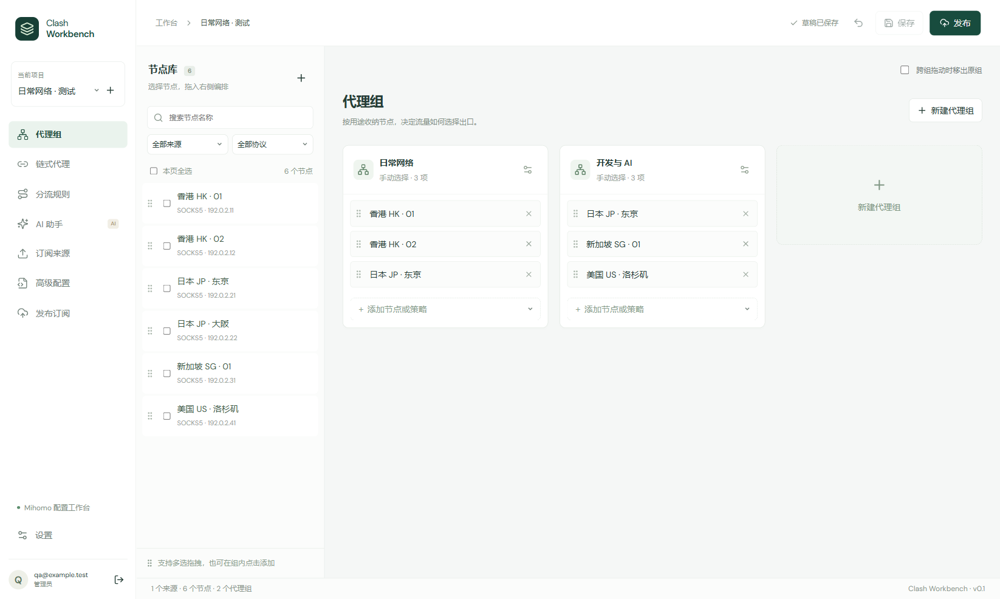
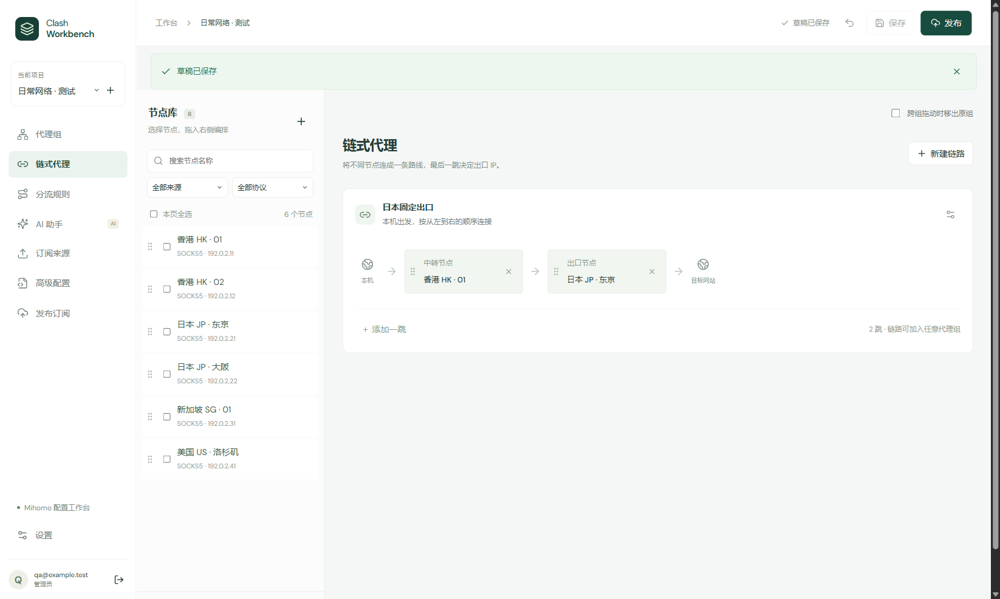

# Clash Workbench

可自托管的多人 Mihomo 订阅与配置工作台。导入订阅链接或 YAML，在浏览器中整理节点、编排代理组和代理链，通过自然语言修改分流规则，再发布为订阅链接、二维码或配置文件。

当前版本为 `0.1.0`，面向 Clash Verge Rev 等使用 Mihomo 内核的客户端。

## 功能

| 模块 | 已实现能力 |
| --- | --- |
| 来源与节点 | 导入多个订阅 URL、YAML、Base64 或节点 URI，解析 HTTP、内联和本地文件节点提供者 |
| 可视化编排 | 节点按国家/地区归类，支持名称与国旗识别；代理组支持名称搜索和多选筛选，保留节点多选拖拽、跨组移动、排序与撤销 |
| 代理组 | 手动选择、自动测速、故障转移、负载均衡，支持组引用和按来源、关键词或 RE2 表达式自动收纳 |
| 链式代理 | 按连接顺序组合具体节点，生成可放入代理组的复合节点，使用 Mihomo `dialer-proxy` 导出 |
| 分流规则 | 手动编辑、排序和禁用规则，接入外部规则集，使用社区规则模板，按域名或 IP 试算 |
| AI 助手 | 接入用户自己的 OpenAI 兼容接口，连续对话生成规则提案，查看差异并确认应用到草稿 |
| 发布与恢复 | 发布稳定订阅链接、二维码和 YAML，轮换或撤销链接，保存历史版本并回滚 |
| 多用户 | 首次注册创建管理员，后续通过一次性邀请码注册，账号之间隔离项目 |

后台默认每 60 分钟同步上游节点。刷新任务将最新节点与已发布的编排组合，检查通过后更新订阅。关键节点失踪、循环引用或内核检查失败时，客户端继续获得上一次可用配置。手工草稿需要主动发布。

## 界面预览

截图使用测试账号和文档保留网段中的示例节点。



<details>
<summary>查看链式代理编辑界面</summary>



</details>

## 快速开始

### 环境要求

- Node.js 24 或更新版本，以及 npm。
- 安装阶段能够访问 GitHub Releases 和 GitHub 原始文件服务。
- Windows 安装 Mihomo 时需要系统提供的 `tar` 命令。

### 本地开发

```sh
git clone https://github.com/Jankin-Chen123/clash-workbench.git
cd clash-workbench
npm ci
npm run setup
npm run dev
```

打开 [本地工作台](http://localhost:5173)。开发服务包含 5173 端口的前端和 3000 端口的 API，默认绑定本机回环地址。

`npm run setup` 安装 Mihomo `v1.19.17` 和 Sub-Store `2.44.30` 解析器，并核对解析器的 SHA-256。下载的程序及其许可证放在 `bin/`，运行数据保存在 `data/`。

首次注册的账号成为管理员。管理员可以在“设置”中生成一次性邀请码，供其他用户注册独立账号。

## 使用流程

1. **创建项目并导入来源。** 第一份完整配置会保留原有节点、代理组、分流、DNS、TUN 和其他高级字段。后续导入会追加节点。若配置引用本地节点提供者文件，可在同一弹窗补传。
2. **编排代理组。** 在节点库中筛选和多选，通过拖拽或组内菜单添加成员。同一节点可以加入多个组，也可启用跨组拖动时移出原组。
3. **搭建代理链。** 创建链路，按“本机 → 入口 → 出口 → 目标网站”的顺序添加至少两个具体节点，再把链路加入代理组。导出时生成独立节点定义，保留原节点的其他用途。
4. **编辑分流规则。** 手动调整规则，接入外部规则集，或应用“国内直连，其余代理”模板。AI 接口、密钥和模型在个人设置中配置，提案确认后写入草稿。
5. **检查并发布。** 保存草稿，查看生成配置和版本差异，通过检查后发布。订阅链接、二维码和文件下载对应已发布版本，历史版本可随时回滚。

## 部署

### 直接运行构建后的应用

复制 `.env.example` 为 `.env`，将 `PUBLIC_URL` 改为用户实际访问的完整地址。例如本机运行构建后的应用时使用 `http://localhost:3000`。

```sh
npm run build
npm start
```

应用默认监听 3000 端口，同时提供 API 和构建后的前端。设置 `NODE_ENV=production` 时，必须提供持久的 `ENCRYPTION_KEY`。

### Docker Compose

需要可用的 Docker Engine 和 Compose。镜像构建过程会安装依赖、下载校验内核并构建前端。

1. 复制 `.env.example` 为 `.env`。
2. 设置 `PUBLIC_URL`、`ENCRYPTION_KEY` 和 `POSTGRES_PASSWORD`。
3. 启动服务。

```sh
docker compose up -d --build
docker compose ps
```

`ENCRYPTION_KEY` 使用随机生成的 64 位十六进制字符串。数据库密码使用单独生成的随机字母数字字符串，避免连接 URL 中的特殊字符。以下 Node.js 命令可分别生成两者。

```sh
node -e "console.log(require('node:crypto').randomBytes(32).toString('hex'))"
node -e "console.log(require('node:crypto').randomBytes(24).toString('hex'))"
```

Compose 运行应用和 PostgreSQL 17，应用端口映射为 `127.0.0.1:3000`。对外提供服务时，为该地址配置 HTTPS 反向代理，并将 `PUBLIC_URL` 设置为对应的 HTTPS 站点地址。单层反向代理设置 `TRUST_PROXY_HOPS=1`。

## 配置与数据

完整配置示例见 [.env.example](.env.example)。

| 变量 | 默认值或说明 |
| --- | --- |
| `PORT` / `HOST` | 直接运行时默认为 `3000` / `127.0.0.1` |
| `PUBLIC_URL` | 默认为 `http://localhost:5173`，用于生成订阅链接和检查请求来源，须与实际浏览器地址一致 |
| `DATABASE_URL` | 留空使用 `data/postgres` 中的 PGlite，填写 PostgreSQL 连接地址后切换数据库 |
| `DATA_DIR` | 本地运行数据目录，默认 `./data` |
| `ENCRYPTION_KEY` | 64 位十六进制密钥，生产环境必填 |
| `POSTGRES_PASSWORD` | Compose 中的 PostgreSQL 密码 |
| `MIHOMO_PATH` | 默认使用 `bin/mihomo.exe` 或 `bin/mihomo` |
| `REFRESH_MINUTES` | 来源刷新周期，默认 60 分钟，最短 5 分钟 |
| `TRUST_PROXY_HOPS` | 直接运行默认 0，Compose 默认 1，复制环境示例后以文件中的值为准 |
| `TRUSTED_FETCH_HOSTS` | 由站长指定、允许访问私网地址的精确主机名，逗号分隔 |
| `SUBSTORE_URL` | 可选的私有 Sub-Store 服务地址，在本地解析器缺失时使用 |

PGlite 适合单进程本地运行。生产环境可使用 PostgreSQL。开发环境首次运行时会生成 `data/encryption.key`，数据库备份需要同时保留对应加密密钥。Compose 数据保存在 `app-data` 和 `pg-data` 卷中，恢复时需保留原来的 `ENCRYPTION_KEY`。

订阅来源、配置快照和模型密钥加密保存。远程请求默认阻止访问回环、私网、链路本地及保留地址，并固定 DNS 解析结果。`TRUSTED_FETCH_HOSTS` 由部署者维护。

在 Clash/Mihomo Fake-IP 环境中，如果域名解析结果全部位于 `198.18.0.0/15`，应用会通过固定公网地址连接的 AliDNS 或 Cloudflare DNS-over-HTTPS 查询真实地址。查询仅包含域名，返回结果仍须通过公网地址检查。公共 DNS 服务不可用时，界面会给出对应提示。

## 支持范围与已知限制

- 当前输出目标为 Mihomo。代理组支持 `select`、`url-test`、`fallback` 和 `load-balance`。旧版 `relay` 会尝试转换为链路，其中的代理组成员需要手动改为具体节点。
- 每个项目最多 100 个来源、10000 个节点，单次远程内容读取上限 5 MB。链路最多 12 跳，协议组合的实际可用性取决于各跳传输能力。
- YAML 按数据结构保留，注释和锚点排版会规范化。节点重名自动改名，节点与代理组同名时需要先修正原文件。
- 节点身份由来源和规范化连接参数确定。单纯上游改名会保留用户别名，连接参数改变会视为新节点，受影响的固定成员与链路需要修复。
- 已有节点提供者的 URL、请求头、过滤和 override 会用于刷新。`use`、`include-all` 与名称过滤会转换为动态成员条件。上游提供者拓扑变化需要重新导入检查，`override-expr` 需要预先转换为静态参数。
- 发布检查使用 Mihomo `-t`。远程规则集和地理数据库采用占位数据检查结构，实际内容与连通性由客户端加载验证。MRS、进程、DNS、地理数据和部分逻辑表达式的试算结果会显示不确定条件。
- AI 使用 OpenAI 兼容的 `/chat/completions` 接口。系统生成的上下文包含规则和策略名称，节点密码、服务器地址、订阅 URL 和模型密钥留在平台内。用户输入的对话内容会发送给所选模型服务。

## 开发与验证

```sh
npm run check
npm test
npm run build
```

测试使用 Node.js 内置测试框架，通过 `tsx` 串行运行。执行前需完成 `npm run setup`。

自动化测试覆盖配置导入、动态过滤、节点身份、引用校验、账号隔离、订阅令牌、回滚、刷新失败保护、AI 接口模拟、Fake-IP 兼容与私网拦截，以及本地受控双跳代理的真实 HTTP 转发。桌面与手机尺寸浏览器流程也已完成检查。

实际外部模型调用、公网节点连通性和 Docker/PostgreSQL 部署尚未完成实测。

## 项目结构

```text
client/              React 界面、样式与静态资源
server/              Express API、导入编译、校验、同步与 AI
shared/              前后端共享的数据模型与引用工具
tests/               核心逻辑、接口与代理链运行测试
scripts/setup.mjs    固定版本依赖安装脚本
docs/images/         README 界面截图
compose.yaml         应用与 PostgreSQL 部署配置
```

贡献前请阅读 [Repository Guidelines](AGENTS.md)。提交问题时可提供复现步骤、客户端与内核版本，并使用脱敏配置描述问题。

## 开源复用与许可证

本项目采用 **AGPL-3.0-only**，许可证正文见 [LICENSE](LICENSE)。

- **Mihomo** 提供配置语法与协议参数校验，采用 GPL-3.0。[项目源码](https://github.com/MetaCubeX/mihomo)
- **Sub-Store** 提供订阅格式解析，采用 AGPL-3.0。解析器在线程中运行，原始输入日志会被屏蔽。[项目源码](https://github.com/sub-store-org/Sub-Store)
- **Loyalsoldier/clash-rules** 提供内置模板引用的社区规则集，采用 GPL-3.0。[规则集来源](https://github.com/Loyalsoldier/clash-rules)
- React、dnd-kit、Express、PGlite、PostgreSQL、yaml、qrcode、diff、RE2JS、Fontsource 和 lucide-react 遵循各自的上游许可证。
